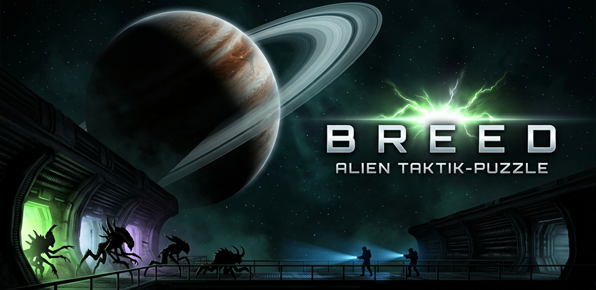
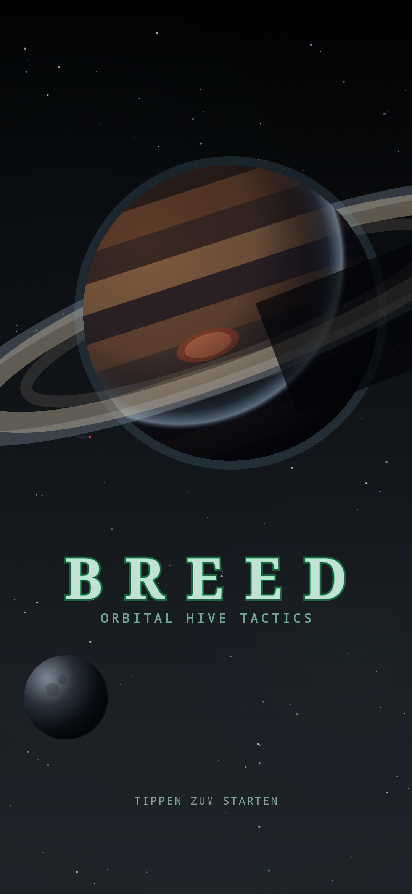
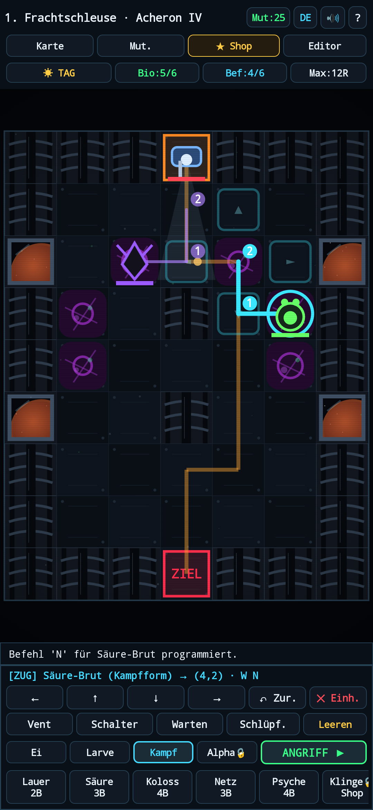
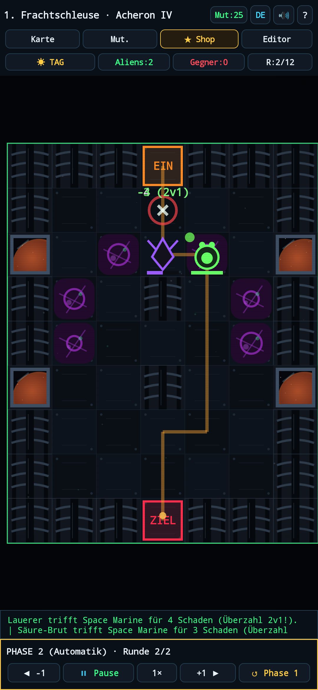
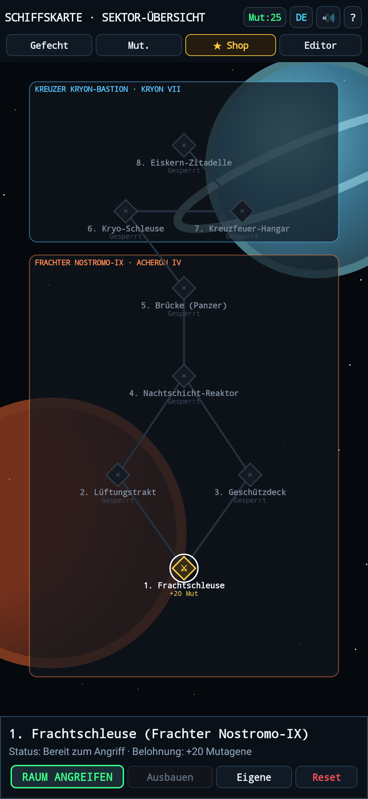

# BREED – Alien Tactical Puzzle (Android)

[](https://github.com/FlowDynamics/Breed/actions/workflows/android-ci.yml)



**BREED** (`com.reeware.android.breed`) ist ein düsteres, im **Hochformat** spielbares Sci-Fi-Taktik- & Schalter-Puzzle für Android – inspiriert von *Alien*, *Alien Breed* und *StarCraft* mit eigenständigem biomechanischem Design.

| Splashscreen | Phase 1: Planung | Phase 2: Gefecht | Schiffskarte |
| :---: | :---: | :---: | :---: |
|  |  |  |  |

---

## Highlights & Features

- **Echtzeit-Hive-Flow-Gameplay (inspiriert von *Colony Flow* × *Alien* / *StarCraft*):**
  - **1-Tipp-Steuerung ohne komplizierte Menüs:** Unten liegen 4 Spalten farbiger **Alien-Kapsel-Blöcke** (🟣 Lauerer, 🟢 Säure-Brut, 🟠 Koloss, 🔵 Netz-Brut, 🩷 Schwarm-Psyche). Ein Tipp schiebt die vorderste Kapsel in einen der **5 aktiven Brut-Slots**!
  - **60-FPS-Echtzeit-Gefechte:** Sofort stürmen deine Aliens nach oben ins biomechanische Raumschiff-Zimmer und bekämpfen die farblich passenden Wachen (Space Marines, Belagerungs-Panzer, Pyro-Wachen, Auto-Geschütze, Kommandanten) an der offenen Front!
  - **Taktisches Reihenfolge-Puzzle:** Verdeckte Wachen hinter anderen Reihen müssen erst freigekämpft werden – füllen sich alle 5 Slots mit blockierten Klassen, droht eine Blockade!
  - **Säurefässer, Doppel-Kapseln & `?`-Kokons:** Explosive Säurefässer sprengen verschlossene Schotts auf; spätere Räume bringen gekoppelte 2-Slot-Kapseln und verdeckte `?`-Kokons.
- **Raumschiff-Kampagne, feste Mutations-Bäume & Raumverlust:**
  - 8 handgefertigte, per Unit-Test als lösbar verifizierte Räume über *Frachter Nostromo-IX* (Acheron IV) und *Kreuzer Kryon-Bastion* (Kryon VII).
  - Raum-Ausbauten (`BROOD_CHAMBER`, `BIO_EXTRACTOR`, `GENE_INCUBATOR`), feste Art-Mutations-Bäume (ohne Arten-Kreuzung) + Alpha-Stufe.
  - Bei einer Niederlage verliert der Spieler einen zuvor eroberten Raum (`RoomStatus.LOST`).
- **Düsterer Weltraum-Splashscreen & prozeduraler Alien-Horror-Soundtrack:**
  - 60-FPS-Intro (`SpaceSplashView`) mit Jupiter-/Saturn-Gasriesen, Ringsystem und mehrfach aufblitzendem **BREED**-Titel.
  - Eigenständige Echtzeit-Audio-Engine (`AlienSoundEngine`) über natives `AudioTrack` (Sub-Drone, dissonante Streicher-Swells, Motion-Tracker-Pings, Phase-2-Herzschlag + 15 Kampf-SFX).
- **Integrierter Hochformat-Level-Editor:**
  - Kacheln, Gegner, Marschrouten, Schalter-Links und Tag/Nacht-Zyklen per Touch gestalten, direkt live testen, lokal speichern und per JSON (`LevelJsonCodec`) teilen.
- **Zweisprachig (DE & EN) & Kostenlos mit optionalen In-App-Käufen:**
  - Vollständig auf **Deutsch & Englisch** (automatisch nach Gerätesprache + `DE`/`EN`-Schalter im HUD).
  - Basisspiel (alle 8 Kampagnen-Räume, 5 Grund-Aliens, Level-Editor) 100 % kostenlos; optionaler Google-Play-Billing-v8-Shop (`8.3.0`, `ShopDialog` / `BillingManager`) für 2 Elite-Aliens (**Klingen-Bestie / Blade Reaper**, **Sporen-Bomber / Spore Bomber**) und 2 ausrüstbare Bio-Waffen.

---

## Dokumentation

- [AGENTS.md](AGENTS.md) – Architektur, Verzeichnisstruktur, lokale Toolchain & Konventionen
- [docs/GAME_DESIGN.md](docs/GAME_DESIGN.md) – Vollständiges Spielkonzept & Regelwerk
- [docs/IMPLEMENTATION_STATUS.md](docs/IMPLEMENTATION_STATUS.md) – Umsetzungsstand & Verifikation
- [docs/PLAY_STORE_CHECKLIST.md](docs/PLAY_STORE_CHECKLIST.md) – Google Play Console Setup, aktive In-App-Produkte, App-Inhalte-Ausfüllhilfe & automatischer Upload
- [docs/PRIVACY_POLICY.md](docs/PRIVACY_POLICY.md) – Zweisprachige Datenschutzerklärung (DE & EN) für Google Play

---

## Build, Tests & Release (PowerShell / Windows)

```powershell
$env:JAVA_HOME = "C:\Program Files (x86)\Android\openjdk\jdk-17.0.12"
$env:PATH = "$env:JAVA_HOME\bin;$env:PATH"
$env:JAVA_TOOL_OPTIONS = "-Djava.net.preferIPv4Stack=true"
$env:GRADLE_OPTS = "-Djava.net.preferIPv4Stack=true"

# Unit-Tests, Debug-APK und signiertes Release-App-Bundle (.aab) bauen:
.\gradlew.bat testDebugUnitTest assembleDebug bundleRelease --no-daemon
```

- **Signiertes Release-Bundle:** `app/build/outputs/bundle/release/app-release.aab`
- **Play-Store-Listings & Grafiken (DE & EN):** `app/src/main/play/listings/{de-DE,en-US}/` (`512×512` `icon.png`, `1024×500` `feature-graphic.png` & `1080×2340` `phone-screenshots/`)
- **Hinweis zu Secrets:** Keystores (`*.keystore`), `signing.properties`, `local.properties` und `secrets/` sind bewusst über `.gitignore` ausgeschlossen und werden nie ins Repository eingecheckt.
